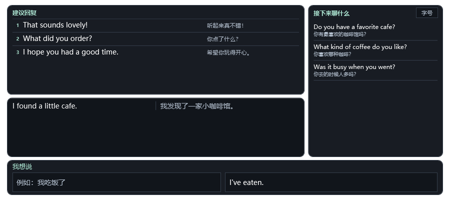

# 声幕 · 英语交流助手

我基于开源项目 VoxRibbon（声幕）二次开发了这个 Windows 工具，方便自己跟外国人语音或视频聊天。对方说英语时，我能看实时中文字幕。想接话时，可以选一句自然的英文。已经想好要说什么，就输入中文，让它翻成能直接说出口的英文。

## 通话时怎么用

- **听懂对方。** 左下方显示英文听写和中文字幕，可以往上翻前面说过的话。英文识别和中文字幕在本机运行。
- **接住话题。** 上方给三条带中文释义的英文回复，右侧提供可以继续聊的英文问题。
- **说自己想说的。** 在底部「我想说」打中文。右侧会边打字边更新英文。按 Enter 可以立即翻译当前输入。例如「我吃饭了」可以说 “I've eaten.”
- **调整显示。** 解锁窗口后，右上角「字号」可调文字大小。按 `Ctrl + Alt + H` 可以隐藏或恢复悬浮窗。

## 安装 Windows 版

从仓库的 **Releases** 下载 `VoxRibbon-Windows.zip`。如果下载的是源码 ZIP，安装脚本会在本机编译桌面悬浮窗。

1. 在 64 位 Windows 10 或 11（Intel / AMD）上，解压整个 ZIP 到固定目录。
2. 安装 [64 位 Python 3.12](https://www.python.org/downloads/windows/)。安装时启用 Python Launcher，或勾选 **Add Python to PATH**。
3. 双击 `01-Install.cmd`。首次安装需要联网下载依赖和约 390 MB 的语音模型。看到 `Installation completed` 后即可关闭安装窗口。
4. 双击 `02-Start.cmd`。打开语音或视频通话，让通话软件使用 Windows 默认声音输出设备。以后双击 `02-Start.cmd` 即可，也可以给它创建桌面快捷方式。

已经在本机配置过的开发版本可以沿用现有快捷方式，或运行 `start-video-chat.ps1`。

## 启用 AI 接话、话题和打字翻译

使用英文听写和中文字幕无需密钥。需要 AI 功能时，到 [DeepSeek 开放平台](https://platform.deepseek.com/api_keys) 创建自己的 API Key。启动声幕后打开 [本机设置](http://127.0.0.1:8765/settings)，勾选「启用 AI 助手」，填写密钥，选择 `deepseek-v4-flash`，再点「测试 DeepSeek 连接」。该按钮也会保存设置。

启用 DeepSeek 后，声幕会把相关听写文字和你输入的中文发给 DeepSeek 处理，由对应账号承担 API 费用。

## 开源来源

- 上游为 [VoxRibbon（lfss-zxj/ai-interview-tools）](https://github.com/lfss-zxj/ai-interview-tools)。本项目保留上游作者署名及 [MIT 许可证](LICENSE)。
- 英文听写使用 [Systran/faster-whisper-tiny.en](https://huggingface.co/Systran/faster-whisper-tiny.en)（MIT），英中字幕使用 [Helsinki-NLP/opus-mt-en-zh](https://huggingface.co/Helsinki-NLP/opus-mt-en-zh)（Apache-2.0）。分享包安装时从 Hugging Face 下载模型，连接失败时尝试 HF-Mirror，并校验文件的 SHA-256。
